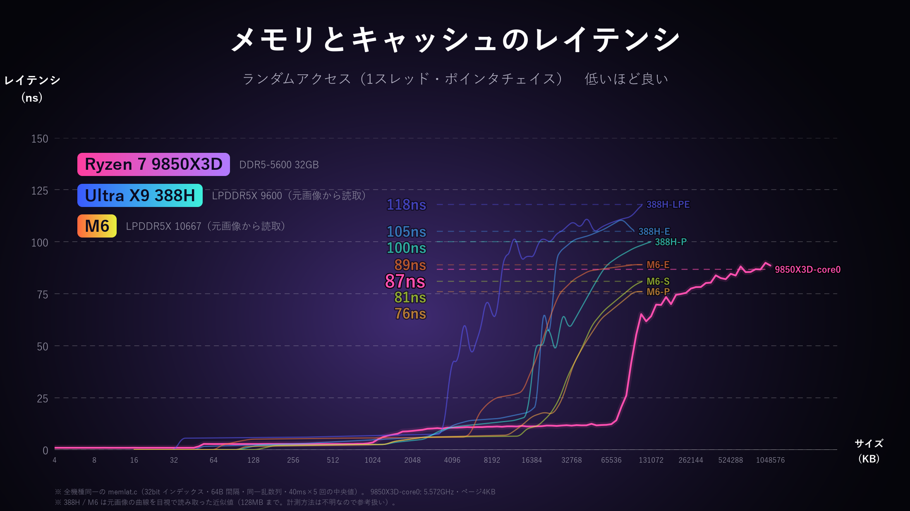

# memlat_kit

[English](README.md) | **日本語**

CPU / GPU のメモリ・キャッシュのレイテンシ（ランダムアクセス）を、**Windows (x86-64) と Apple Silicon Mac で同じ条件**で測り、
比較グラフを作るツールです。



> **注意:** 同梱の `results/` と `docs/` の画像は暫定データです（Windows 機の一部コアと GPU は再計測予定）。

## 使い方

### Mac (Apple Silicon)

```bash
git clone https://github.com/AoTofu/memlat_kit.git
cd memlat_kit
bash run_mac.sh          # 設定画面が開く
bash run_mac.sh --yes    # 設定画面を出さず既定値で実行
```

- 電源アダプタにつなぎ、低電力モードを OFF にし、ほかのアプリを閉じてから実行してください（既定値で 10〜15 分）
- 初回は Xcode Command Line Tools のインストール画面が出ます。インストール後にもう一度 `bash run_mac.sh`
- `results/mac-<チップ名>/` に CSV、`results/*.png` にグラフ、`mac-<チップ名>.zip` に計測データができます

### Windows

```powershell
git clone https://github.com/AoTofu/memlat_kit.git
cd memlat_kit
.\run_windows.ps1          # 設定画面が開く
.\run_windows.ps1 --yes    # 設定画面を出さず既定値で実行
python plot.py             # グラフだけ作り直す
```

必要なもの: Python 3.9 以上、clang または gcc（例: `scoop install llvm` / `winget install LLVM.LLVM`）。
GPU 計測は OpenCL ドライバ（NVIDIA / AMD / Intel の通常のドライバに含まれます）。

### 設定画面

起動すると次の画面が出ます。番号を入力すると変更、Enter でそのまま開始、`d` で既定値に戻します。
**既定値は、作者の環境（Ryzen 7 9850X3D + RTX 5080）で計測したときと同じ条件**です。変更した項目には `*` が付きます。

```
==== メモリレイテンシ計測  設定 ====
  1. 計測対象              : CPU + GPU
  2. CPU コア              : 0,14          論理CPU番号をカンマ区切り (Mac は P,E)
  3. CPU 最大サイズ (MB)   : 1024
  4. ノード間隔 (B)        : 64            128 にすると Apple のライン長に合わせた条件
  5. CPU 1回の計測時間 (ms): 40
  6. CPU 計測回数 (中央値) : 5
  7. GPU 最大サイズ (MB)   : 2048          GPU のメモリ量に応じて自動で小さくなる
  8. GPU パス数 (中央値)   : 3
  9. GPU 1回のステップ数   : 300000
 10. GPU クロック固定      : 両方 (固定なし + 固定)   NVIDIA のみ。固定時は UAC で管理者権限
 11. 元画像の参考曲線      : 表示する
 12. 終了後にグラフを      : 開く

 Enter: この設定で開始   番号: 変更   d: 既定値に戻す   q: 終了
```

- CPU コアの既定値は、Windows では「先頭の物理コアと最後の物理コア」（作者の PC では論理 0 と 14）、Mac では `P,E`
- 使った設定は `results/<機種>/machine.json` に保存され、CSV の先頭にも記録されます
- Mac では GPU クロックを固定できないため、10 は「固定しない」だけになります

### 結果の追加

`results/` 以下の全機種のデータが同じグラフにまとめて描かれます。別の PC / Mac の `results/<機種>/` フォルダをコピーして
`python plot.py` を実行すれば比較できます。プルリクエストで結果を追加してもらうことも想定しています。

## 出力

| ファイル | 内容 |
|---|---|
| `results/cpu_latency.png` | CPU の実測値のみ |
| `results/cpu_latency_ref.png` | 上記に、元のスライド（Ultra X9 388H / M6）の曲線を参考として重ねたもの |
| `results/gpu_latency.png` | GPU |
| `results/<機種>/cpu_*.csv`, `gpu*.csv` | 生データ。先頭の `#` 行に CPU 名・実効クロック・ページサイズなど |
| `results/<機種>/machine.json` | 機種情報（グラフのラベルに使用） |

## 公平に比べるために揃えていること

| 項目 | 内容 | 理由 |
|---|---|---|
| プログラム | CPU は同じ `memlat.c`、GPU は同じ `gpulat.py`（OpenCL） | 実装の違いをなくす |
| コンパイラ | 両方とも clang `-O2` | 内側のループは ARM `ldr w, [x, x, lsl #2]`、x86 `mov (%r,%r,4)` の 1 命令ずつで、同等のコードになることを確認済み |
| アクセス方式 | **32bit の番号**を辿る（生のポインタは使わない） | Apple M シリーズの DMP（ポインタらしい値を先読みする仕組み。GoFetch で知られる）でポインタチェイスが速く見えるのを防ぐ。x86 も同じ方式 |
| アクセス順 | 64B 間隔のノードを 1 周のランダム順で辿る。**乱数シードも同じ** | 両方の機種でまったく同じ順番になる |
| サイズ | 4KB〜1GB（GPU は最大 2GB）、2 倍ごとに 8 点 | 同じ点で比べる |
| 計測 | 各サイズでウォームアップ後、40ms × 5 回の中央値。GPU は 30 万ステップ × 5 回の中央値を 3 パス測って中央値 | 外れ値に強くする |
| 実効クロック | 依存した加算の連鎖で測って CSV に記録 | ns をサイクル数に換算でき、P / E どちらのコアで動いたかも確かめられる |

## 揃えられないこと（結果を見るときの注意）

- **コアの指定**: Windows は論理 CPU に固定（アフィニティ）。macOS には固定する方法がないため、QoS で指定します
  （`USER_INTERACTIVE` → P コア、`BACKGROUND` → E コア）。BACKGROUND の E コアは低いクロックで動くことがあり、
  その値も「E コアで動かしたときの実際の値」として記録されます（CSV の `ghz_start` を見てください）。
  コアが 3 種類あるチップでは、中間のコアは指定できません。
- **ページサイズ**: Windows は 4KB、macOS は 16KB。大きいサイズでは TLB ミスの量が変わります（OS の仕様なので、実際の使用でも同じ差が出ます）。
- **キャッシュライン**: x86 は 64B、Apple は 128B と報告されています。ノードは 64B 間隔なので、Apple では 1 つのラインに 2 ノードが入ります
  （x86 も隣のラインを一緒に読み込むプリフェッチがあるので、条件はおおむね同じです）。
- **GPU のクロック**: Windows は `nvidia-smi` で固定できます（設定画面の 10 番）。macOS には固定する方法がありません。
  グラフは固定した結果があればそれを使い、固定なしの結果（`gpu_unlocked.csv`）も残します。
- **GPU のメモリ**: Apple の GPU は CPU と同じ LPDDR を共有します（ユニファイドメモリ）。単体 GPU は専用の GDDR を使います。
- **参考曲線（388H / M6）**: 元のスライドのグラフを目で見て読み取ったおおよその値です（`refdata.py`）。測定ツールや条件が分からないため、参考としてのみ表示します。

## ファイル構成

```
bench.py          設定画面つきのランチャー（計測・グラフ作成をまとめて実行）
memlat.c          CPU 計測（Windows / macOS 共通の C コード）
gpulat.py         GPU 計測（OpenCL / pyopencl）
plot.py           グラフ作成（python plot.py で単独実行も可）
refdata.py        参考曲線（元スライドから読み取った値）
run_mac.sh        Mac 用ランチャー（環境の準備 → bench.py）
run_windows.ps1   Windows 用ランチャー（環境の準備 → bench.py）
results/          計測結果（機種ごとのフォルダ）
docs/             README 用の画像
```

## 参考資料

- Apple の DMP と GoFetch: [Wikipedia: GoFetch](https://en.wikipedia.org/wiki/GoFetch)、[Augury (IEEE S&P 2022)](https://ieeexplore.ieee.org/document/9833570)
- macOS の QoS とコアの割り当て: [Eclectic Light](https://eclecticlight.co/2025/05/09/what-is-quality-of-service-and-how-does-it-matter/)、[Apple Developer Forums](https://developer.apple.com/forums/thread/674456)
- Apple Silicon の OpenCL（非推奨だが動作する）: [Apple Developer Forums](https://developer.apple.com/forums/thread/694866)、[pyopencl](https://pypi.org/project/pyopencl)

## ライセンス

MIT
