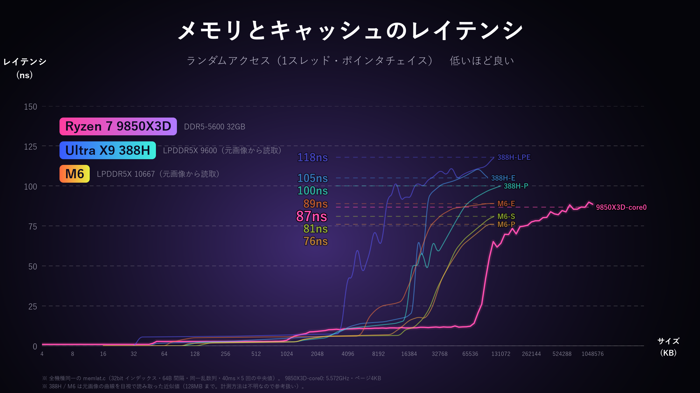

# memlat_kit

**English** | [日本語](README.ja.md)

Measures CPU / GPU memory and cache latency (random access) on **Windows (x86-64) and Apple Silicon Macs under the same conditions**,
and draws comparison charts.



> **Note:** The data in `results/` and the images in `docs/` are preliminary (some cores and the GPU on the Windows machine will be re-measured).

## Usage

### Mac (Apple Silicon)

```bash
git clone https://github.com/AoTofu/memlat_kit.git
cd memlat_kit
bash run_mac.sh          # opens the settings screen
bash run_mac.sh --yes    # skip the settings screen and run with defaults
```

- Plug in the power adapter, turn Low Power Mode off, and close other apps before running (about 10–15 minutes with the defaults).
- The first run may show the Xcode Command Line Tools installer. After it finishes, run `bash run_mac.sh` again.
- CSVs go to `results/mac-<chip>/`, charts to `results/*.png`, and the measurement data is also zipped as `mac-<chip>.zip`.

### Windows

```powershell
git clone https://github.com/AoTofu/memlat_kit.git
cd memlat_kit
.\run_windows.ps1          # opens the settings screen
.\run_windows.ps1 --yes    # skip the settings screen and run with defaults
python plot.py             # only redraw the charts
```

Requirements: Python 3.9+, clang or gcc (e.g. `scoop install llvm` / `winget install LLVM.LLVM`).
GPU measurement needs an OpenCL driver (included with the regular NVIDIA / AMD / Intel drivers).

### Settings screen

On start you get the screen below. Type a number to change an item, press Enter to start, or `d` to restore the defaults.
**The defaults are the exact conditions used on the author's machine (Ryzen 7 9850X3D + RTX 5080).** Changed items are marked with `*`.
(The screen itself is in Japanese; the English labels are shown here.)

```
==== Memory latency benchmark  Settings ====
  1. Target                    : CPU + GPU
  2. CPU cores                 : 0,14          logical CPU numbers, comma separated (P,E on Mac)
  3. CPU max size (MB)         : 1024
  4. Node stride (B)           : 64            128 matches Apple's cache line length
  5. CPU time per run (ms)     : 40
  6. CPU runs (median)         : 5
  7. GPU max size (MB)         : 2048          reduced automatically to fit GPU memory
  8. GPU passes (median)       : 3
  9. GPU steps per run         : 300000
 10. GPU clock lock            : both (unlocked + locked)   NVIDIA only; locking needs admin rights (UAC)
 11. Reference curves          : show
 12. Open charts when finished : yes

 Enter: start with these settings   number: change   d: restore defaults   q: quit
```

- Default CPU cores: on Windows, the first and the last physical core (logical 0 and 14 on the author's PC); on Mac, `P,E`.
- The settings used are saved in `results/<machine>/machine.json` and in the header of every CSV.
- GPU clocks cannot be locked on macOS, so item 10 only offers "unlocked" there.

### Adding results

Every machine folder under `results/` is drawn on the same charts. Copy another PC's / Mac's `results/<machine>/` folder
here and run `python plot.py` to compare. Pull requests adding results are welcome.

## Output

| File | Contents |
|---|---|
| `results/cpu_latency.png` | Measured CPU results only |
| `results/cpu_latency_ref.png` | The above plus the curves from the original slide (Ultra X9 388H / M6) for reference |
| `results/gpu_latency.png` | GPU |
| `results/<machine>/cpu_*.csv`, `gpu*.csv` | Raw data. `#` header lines record the CPU name, effective clock, page size, etc. |
| `results/<machine>/machine.json` | Machine info (used for chart labels) and the settings used |

## What is kept identical for a fair comparison

| Item | What | Why |
|---|---|---|
| Program | Same `memlat.c` for CPU, same `gpulat.py` (OpenCL) for GPU | No implementation differences |
| Compiler | clang `-O2` on both | The inner loop compiles to a single load on both: ARM `ldr w, [x, x, lsl #2]` / x86 `mov (%r,%r,4)` (verified) |
| Access | Follows **32-bit indices**, not raw pointers | Prevents Apple M-series' DMP (a prefetcher that follows pointer-like values, known from GoFetch) from making the pointer chase look faster. x86 uses the same scheme |
| Order | 64B-spaced nodes visited in one random cycle, **with the same random seed** | Exactly the same access order on both machines |
| Sizes | 4KB to 1GB (GPU up to 2GB), 8 points per doubling | Compared at the same points |
| Timing | After warm-up, median of 40ms × 5 runs per size. GPU: median of 300k steps × 5 runs, then median over 3 passes | Robust to outliers |
| Effective clock | Measured with a dependent add chain and recorded in the CSV | Lets you convert ns to cycles and confirm whether a P or E core was used |

## What cannot be made identical (read results with this in mind)

- **Core selection**: Windows pins to a logical CPU (affinity). macOS has no way to pin, so a QoS class is used instead
  (`USER_INTERACTIVE` → P core, `BACKGROUND` → E core). E cores at BACKGROUND may run at a low clock; that is recorded as
  "the actual value when run on an E core" (see `ghz_start` in the CSV). On chips with three core types the middle type cannot be selected.
- **Page size**: 4KB on Windows, 16KB on macOS. This changes the amount of TLB misses at large sizes (an OS property, so real workloads see the same difference).
- **Cache line**: 64B on x86; reported as 128B on Apple. With 64B node spacing, two nodes share one line on Apple
  (x86 also has an adjacent-line prefetcher that fetches line pairs, so conditions are roughly symmetric).
- **GPU clock**: can be locked on Windows with `nvidia-smi` (item 10 in the settings). macOS has no way to lock it.
  Charts use the locked result when present; the unlocked result (`gpu_unlocked.csv`) is kept too.
- **GPU memory**: Apple GPUs share the same LPDDR as the CPU (unified memory). Discrete GPUs use their own GDDR.
- **Reference curves (388H / M6)**: approximate values read by eye from the original slide's chart (`refdata.py`). The tool and conditions used are unknown, so they are shown for reference only.

## Files

```
bench.py          Launcher with the settings screen (runs measurements and charts)
memlat.c          CPU benchmark (shared C code for Windows / macOS)
gpulat.py         GPU benchmark (OpenCL / pyopencl)
plot.py           Chart drawing (can also be run on its own: python plot.py)
refdata.py        Reference curves (values read from the original slide)
run_mac.sh        Mac launcher (sets up the environment -> bench.py)
run_windows.ps1   Windows launcher (sets up the environment -> bench.py)
results/          Measurement results (one folder per machine)
docs/             Images for the README
```

## References

- Apple's DMP and GoFetch: [Wikipedia: GoFetch](https://en.wikipedia.org/wiki/GoFetch), [Augury (IEEE S&P 2022)](https://ieeexplore.ieee.org/document/9833570)
- macOS QoS and core allocation: [Eclectic Light](https://eclecticlight.co/2025/05/09/what-is-quality-of-service-and-how-does-it-matter/), [Apple Developer Forums](https://developer.apple.com/forums/thread/674456)
- OpenCL on Apple Silicon (deprecated but working): [Apple Developer Forums](https://developer.apple.com/forums/thread/694866), [pyopencl](https://pypi.org/project/pyopencl)

## License

MIT
